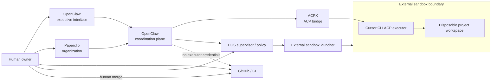

# Architectural baseline (provisional)

This document describes a **candidate logical architecture**. It does not represent an existing deployment or end-to-end validation.

## Candidate logical diagram

Detailed sandbox threat model and design (documentation only; not runtime-validated):

- [`sandbox-threat-model.md`](sandbox-threat-model.md)
- [`sandbox-design.md`](sandbox-design.md)

## Intended responsibilities

| Component | Candidate responsibility | Maturity |
|-----------|--------------------------|----------|
| Paperclip | Organization, goals, projects, agents, tasks, budgets, and tracking | Hypothesis / evaluation pending |
| OpenClaw (executive interface) | Human direction channel and operational visibility | Capability documented in ecosystem; EOS integration pending |
| OpenClaw (coordination plane) | Orchestration across projects/agents and tools | Hypothesis / PoC pending |
| ACPX | Bridge between OpenClaw and ACP executors | PoC pending; presence not conclusive in inventory |
| Cursor CLI ACP | First engineering executor via ACP | CLI help observed; real session pending |
| External sandbox | Effective isolation per project or run | Design documented in M03-00; runtime PoC pending |
| EOS supervisor / launcher | Policy decision and host-side sandbox launch | Design intent only |
| GitHub / CI | Authority for commits, PRs, checks, and merges | Recommended; EOS wiring pending |

## Executive interface vs coordination

- **Executive interface:** Owner-facing surface (inspect state, authorize, escalate).
- **Coordination plane:** Logic linking goals, tasks, executors, and evidence.

Both may live in the same product (e.g. OpenClaw) but must be modeled as distinct roles so UX is not confused with enforcement.

## Trust boundaries

1. **Owner / human:** highest decision trust.
2. **Control plane (Paperclip/OpenClaw):** trusted to orchestrate within policy; not equivalent to code isolation.
3. **Executor (Cursor ACP):** semi-trusted; must run inside a sandbox.
4. **Sandbox:** technical containment boundary; failure here stops autonomy.
5. **GitHub:** source of truth for code integration.
6. **Prompts / AGENTS.md / cwd:** **not** sufficient trust boundaries.

## Sources of truth by domain

| Domain | Intended source of truth |
|--------|--------------------------|
| Goals, budget, assignment | Paperclip (candidate) |
| Coordination state / agent sessions | OpenClaw (candidate) |
| Code and history | Git / GitHub |
| CI outcomes | GitHub checks |
| Architecture decisions | Versioned ADRs in this repo |
| Work plan | `docs/backlog.yaml` + tasks |
| Validation evidence | Task reports + cited artifacts |

## Capabilities, hypotheses, and PoCs

| Claim | Classification |
|-------|----------------|
| Governance documentation exists in this repo | Documentary capability (M00-01) |
| Cursor CLI offers an ACP subcommand | Partial capability observed; real session pending |
| OpenClaw can coordinate ACP executors via ACPX | Hypothesis / PoC pending |
| Paperclip will cover organization and costs | Hypothesis / evaluation pending |
| An external sandbox will contain the Cursor ACP harness | Requirement; design in M03-00; PoC pending |
| GitHub will be integration authority | Recommended decision; wiring pending |

## Mandatory sandbox for the Cursor ACP harness

Any autonomous Cursor ACP executor run against project code **requires** an effective external sandbox.

It is **forbidden** to treat as sufficient isolation:

- the working directory (`cwd`);
- rules in `AGENTS.md` or other markdown;
- task prompts;
- naming or branch conventions;
- Cursor CLI `--sandbox` flags alone.

Application-level restrictions are **not** equivalent to host-enforced isolation. See the M03-00 design documents for the planned enforcement model.

Without the SANDBOX gate at `PASS`, there is no autonomy on real projects. M03-00 does not move that gate.
