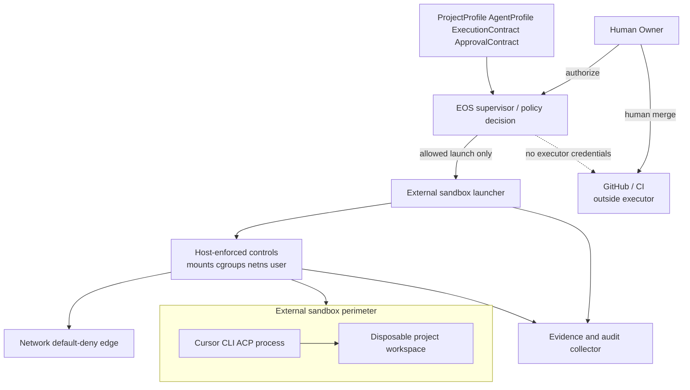

# External sandbox design (M03-00)

**Maturity:** Design recommendation for M03-01 — **not validated**.  
**Explicit non-claim:** No sandbox was implemented, installed, launched, or runtime-tested in this increment.  
**CLI note:** Cursor CLI `--sandbox` flags are application-level hints and are **not** Engineering OS external isolation.

## 1. Security objectives

The sandbox must enforce the Engineering OS execution boundary **outside** the agent process:

1. Filesystem isolation between host and executor.
2. Isolation between independent projects.
3. Read-only versus writable mounts explicitly declared.
4. No inherited host HOME.
5. No inherited SSH agent or cloud credentials.
6. No direct access to GitHub credentials.
7. No Docker/Podman host control socket inside the executor.
8. Least privilege and non-root execution.
9. Network egress default-deny with explicit destination allow-lists when approved.
10. DNS restrictions and documented bypass considerations.
11. CPU, memory, disk, process, and execution-time limits.
12. Process termination and cleanup.
13. Logging with sanitization of evidence.
14. Containment of Git writes and cross-project access.
15. Recovery/cleanup after crashes.
16. Rejection of security claims based only on prompts, cwd, or CLI flags.

## 2. High-level architecture

### Trust boundary notes

| Element | Role |
|---------|------|
| Supervisor / policy decision | Evaluates contracts and approvals on the host; refuses launch without required fields |
| External sandbox launcher | Creates disposable namespace/container/VM; never trusts agent self-report |
| Host-enforced controls | Mounts, user, cgroups, network, DNS — effective outside ACP |
| Cursor CLI ACP inside sandbox | Semi-trusted executor; may be hostile or confused |
| Disposable workspace | Only authorized writable tree for the run |
| Network edge | Default deny; exceptions require ApprovalContract + launcher config |
| Evidence collector | Host-side capture; treat in-sandbox logs as untrusted alone |
| GitHub outside executor | Integration plane; human approval/merge for MVP |

## 3. Contract → enforcement mapping

Engineering OS contracts are **EOS-owned**. They are not native Cursor / OpenClaw / ACPX / Paperclip formats.

| Contract | Fields informing enforcement | Planned host control |
|----------|------------------------------|----------------------|
| `ProjectProfile` | `isolation.mode`, `scope.*`, `execution_policy.git_write_default` | Per-project mount set; deny cross-project; deny git write in executor |
| `AgentProfile` | `tool_access.denied`, `assigned_project_ids`, escalation list | Drop denied tools/env; refuse unassigned projects |
| `ExecutionContract` | `scope`, `sandbox.required`, `network_policy`, `ceilings`, `git_write.enabled=false` | Enforce mounts, net default-deny, cgroup/time limits; block git write |
| `ApprovalContract` | Scoped exceptions, expiry, constraints | Launcher accepts exceptions only after independent checks; never bypass sandbox or human merge |

Approvals do **not** grant technical access by themselves. The launcher must re-validate identity, scope, expiry, and replay.

## 4. Technology assessment

Optional read-only presence checks observed during M03-00 (non-mutating; no daemons started for configuration):

| Tool | Observed presence | Notes |
|------|-------------------|-------|
| Podman | Not on PATH | Candidate still preferred for rootless posture where operable |
| Docker | Present (client version observed) | Availability ≠ acceptable security posture |
| `unshare` | Present | Useful primitive; incomplete product boundary alone |

### Comparison

| Approach | Security boundary | WSL2 fit | Ops complexity | ACP stdio | Overhead | Reproducibility | Evidence needed before adoption |
|----------|-------------------|----------|----------------|-----------|----------|-----------------|----------------------------------|
| Rootless Podman | User namespaces + OCI mounts/net/cgroups | Generally good when rootless works | Medium | Good (attach stdio) | Medium | High with image pins | Rootless mode, no socket mount, net deny, negative tests |
| Rootless Docker | Similar if truly rootless | Variable on WSL2 | Medium–high | Good | Medium | High | Prove rootless (not rootful), no docker.sock, same negatives |
| Linux namespaces + bind mounts (`unshare`/bwrap-class) | Strong if correctly composed; easy to misconfigure | Native Linux/WSL2 | High (bespoke) | Good | Low–medium | Medium | Full mount/net/user checklist + negatives |
| Disposable VM | Stronger isolation | Heavier on WSL2/Hyper-V | High | Harder stdio/UX | High | Medium | Boot/cleanup automation + negatives |

### Recommendation for M03-01 (unvalidated)

**Candidate:** rootless OCI container launcher patterned for **Podman rootless**, with a documented fallback to **rootless Docker** only if Podman cannot be operated safely on the Owner host.

**Rationale:** OCI containers give inspectable mounts, user mapping, cgroups, and network namespaces with manageable ACP stdio wiring—without selecting a tool merely because Docker is on PATH.

**This recommendation is not validated.** M03-01 must prove enforcement with negative tests. If rootless OCI cannot meet the threat model on WSL2, escalate to disposable VM evaluation rather than weaken controls.

## 5. Planned control baseline

### Filesystem

- Read-only root filesystem for the executor image/tree.
- Bind-mount only the disposable project workspace as writable.
- Do not mount host HOME, SSH dirs, cloud config, sibling projects, or secrets canaries as readable.
- `cwd` inside sandbox is the workspace mount; cwd alone is not the control.

### Identity and privileges

- Non-root user inside the sandbox.
- Drop Linux capabilities not required.
- No privileged mode.
- No inherited host UID mapping that re-exposes host HOME files unexpectedly.

### Environment

- Start from a minimal env allow-list.
- Do not forward `SSH_AUTH_SOCK`, cloud SDK vars, or GitHub tokens.
- Set a synthetic `HOME` inside the sandbox with no host credentials.

### Network

- Default-deny egress.
- No access to link-local/metadata endpoints.
- DNS policy must not provide an unintended bypass; document resolver path in PoC evidence.
- Any allow-list destination requires ApprovalContract + launcher encoding.

### Runtime sockets

- Never mount Docker/Podman host sockets into the executor.

### Resources and lifecycle

- CPU, memory, PIDs, disk, and wall-clock limits from `ExecutionContract.ceilings`.
- Kill process tree on limit or cancellation.
- Always dispose workspace and network/cgroup artifacts after exit or crash.

### Git and GitHub

- Executor: no git write / push credentials.
- Host integration plane + human Owner perform commit/PR/merge for MVP.
- Cross-project access denied by mount policy.

### Evidence

- Host-side collector records launcher config summary (sanitized), exit codes, and negative-test results.
- Strip secrets/paths that identify the real host user profile before publishing to the public repo.

## 6. ACP integration considerations

From M01-00: `cursor-agent acp` is documented as starting an ACP server; ACP-specific CLI flags beyond `--help` were not documented.

Design implications:

1. Prefer supervisor-managed stdio/socket plumbing into the sandboxed process.
2. Do not assume undocumented parent CLI flags apply inside ACP mode.
3. Treat any host-side ACP client as part of the trusted supervisor only if it cannot grant mounts/network itself.
4. Live ACP sessions remain forbidden until SANDBOX evidence exists for the intended run class (M01-01 depends on `M03-02`).

## 7. M03-01 proof-of-concept specification

### Scope

Disposable synthetic projects only (for example `synth-alpha` and `synth-beta`), canary files, no real secrets, no real GitHub credentials, no production repos.

### Required demonstrations

| ID | Demonstration | PASS | FAIL | BLOCKED | NOT_TESTED |
|----|---------------|------|------|---------|------------|
| P1 | Allowed write inside workspace | Write succeeds; content verified | Write fails incorrectly | Launcher unavailable | Not run |
| P2 | Denied write outside workspace | Denied; outside canary unchanged | Outside modified | Cannot place canary safely | Not run |
| P3 | Denied second project | Access fails | Content readable | Fixture missing | Not run |
| P4 | Denied host-secret canary | Access fails | Readable | Cannot create canary without risk | Not run |
| P5 | Denied network default | Egress fails | Egress succeeds | Network harness missing | Not run |
| P6 | Resource/time limit | Process killed by limit | Continues unbounded | cgroup unsupported | Not run |
| P7 | Clean shutdown + dispose | No leftover workspace/netns | Leftover state | Cleanup hooks missing | Not run |
| P8 | No runtime socket | Socket access fails | Socket usable | N/A | Not run |

### Evidence pack for each PASS

1. Exact launcher invocation (sanitized).
2. Mount/network/user summary.
3. Commands inside sandbox and exit codes.
4. Before/after hashes or contents of canaries.
5. Explicit statement of what was **not** tested.

### Gate rule

- M03-01 may PASS as a PoC only with reproducible negative-test evidence.
- **M03-02 / SANDBOX gate remains NOT_TESTED** until independent enforcement tests succeed and are reviewed.
- Success of M03-00 documentation alone never moves the SANDBOX gate.

## 8. Unresolved decisions

1. Final choice between Podman rootless, rootless Docker, or VM if OCI rootless fails on WSL2.
2. Exact DNS architecture that prevents bypass without breaking approved allow-lists.
3. How ACP transport will be supervised once session testing is authorized.
4. Whether read-only mounts of language toolchains are required for the first PoC or deferred.
5. Evidence retention location and redaction automation for a public repository.
