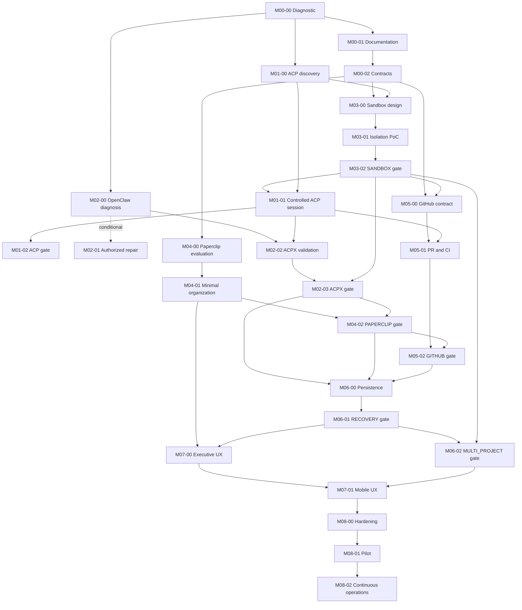

# Roadmap — Engineering OS

## Numbering vs execution order

Milestone numbers (`M00`…`M08`) identify work domains. They do **not** necessarily match real execution order. Effective order is defined by [backlog](backlog.yaml) dependencies and blocking gates.

In particular, isolation tests (**M03**) must pass **before** autonomous execution on real projects is allowed, even though Cursor ACP validation (**M01**) and OpenClaw/ACPX (**M02**) may start in parallel at discovery level.

## Milestones

| ID | Name | Goal |
|----|------|------|
| M00 | Documentation, baseline, and contracts | Documentary foundation, governance, and canonical contracts |
| M01 | Cursor ACP | Validate the Cursor CLI ACP executor |
| M02 | OpenClaw and ACPX | Validate coordination and ACP integration via OpenClaw/ACPX |
| M03 | Sandbox and isolation | Demonstrate effective external isolation |
| M04 | Paperclip and organization | Enterprise organization, goals, and tracking |
| M05 | GitHub, CI, and reconciliation | Integration authority and cycle closure |
| M06 | Persistence, recovery, and multi-project | Durability, recovery, and multi-project segregation |
| M07 | Mobile executive experience | Executive interface usable on mobile |
| M08 | Hardening, pilot, and operations | Controlled pilot and continuous operations |

## Blocking gates

No later increment may declare operational autonomy on real projects while these gates fail or remain open:

| Gate | Meaning |
|------|---------|
| ACP | Cursor CLI ACP executor demonstrates a controlled session and delivery |
| ACPX | OpenClaw ↔ ACP executor integration is validated or discarded with evidence |
| SANDBOX | Effective external isolation exists; prompts/cwd/rules are not enough |
| PAPERCLIP | Organizational layer can govern goals, agents, and costs |
| GITHUB | Commits/PRs/checks/merges remain under GitHub + human authority |
| RECOVERY | Persistence and recovery allow resume without state corruption |
| MULTI_PROJECT | Segregation between projects is effective and verifiable |

## Conditional exception: M02-01

`M02-01` (authorized OpenClaw fix) runs **only** if diagnosis shows a necessary repair and the Owner authorizes it. The backlog YAML does not express conditional dependencies: `M02-02` depends on `M02-00` and `M01-01`, **not** on `M02-01`. If `M02-01` is unnecessary, it does not block progress.

## Dependencies (view)

## M03 security rule

Until `M03-02` (SANDBOX gate) is `PASS` with external evidence, **no** autonomous execution on real projects is authorized. M01/M02 discovery may continue in a controlled, low-risk mode without treating the host environment as sufficient.
